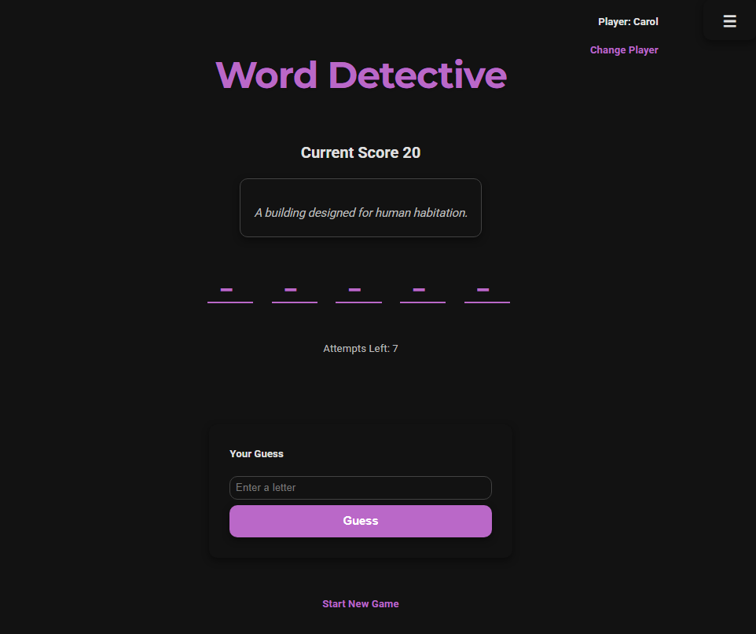
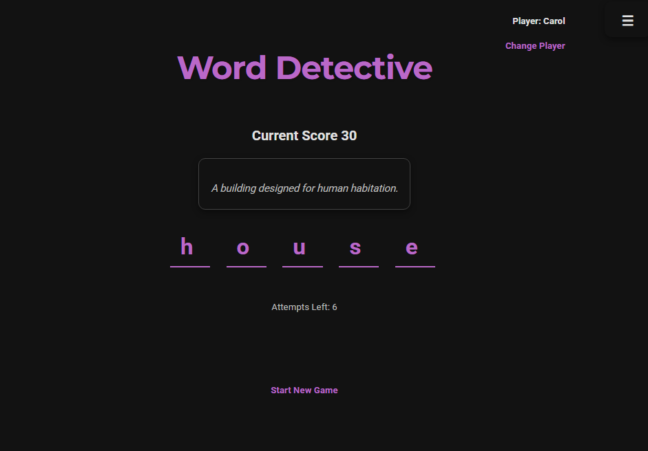
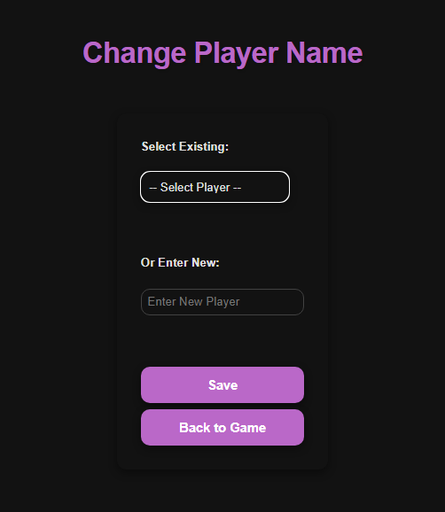
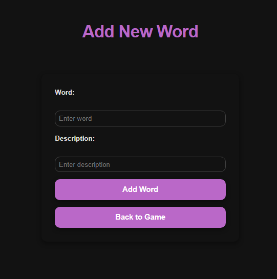
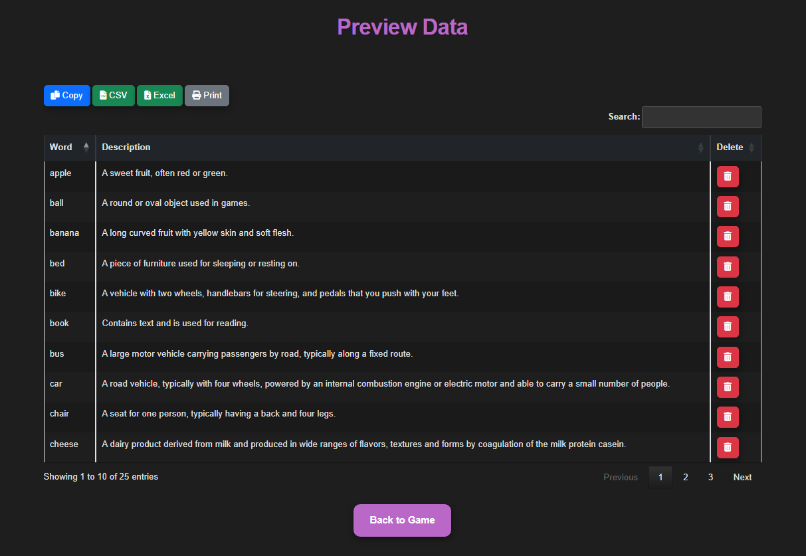
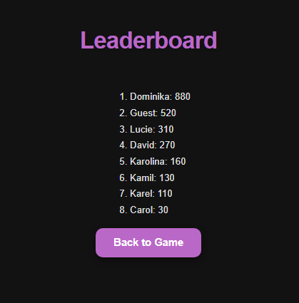
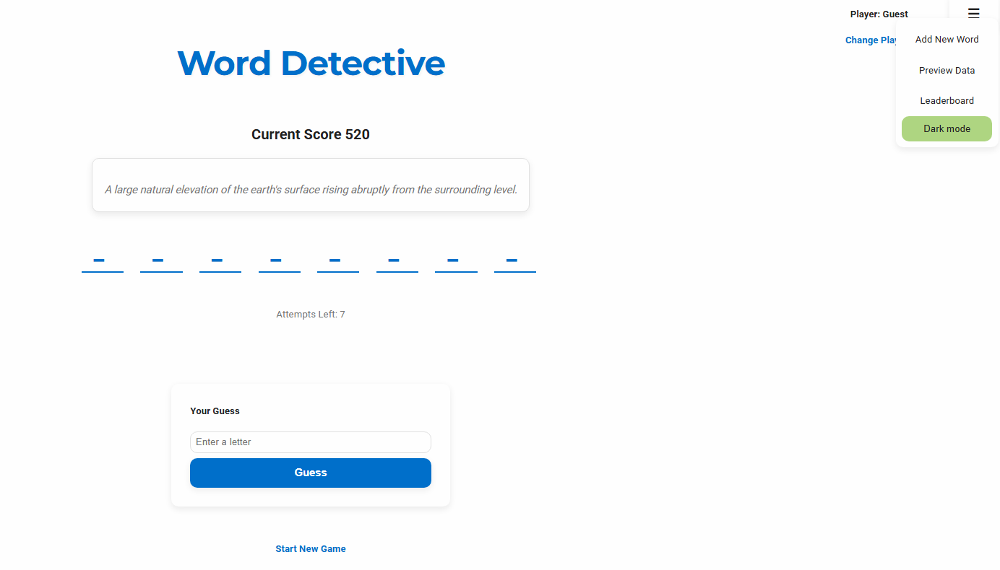

# 🎮 Word Detective 🕵️

<div align="center">

  <a href="https://github.com/hrosicka/WordDetective/stargazers">
    
  </a>
  <a href="https://github.com/hrosicka/WordDetective/network/members">
    
  </a>
  <a href="https://github.com/hrosicka/WordDetective/graphs/contributors">
    
  </a>
  <a href="https://github.com/hrosicka/WordDetective/commits/master">
    
  </a>
  <a href="https://github.com/hrosicka/WordDetective/issues">
    
  </a>
  <br/>

  <a href="https://www.python.org/">
    
  </a>
  
  
  
  
  <br/>

  <a href="LICENSE">
    
  </a>

</div>

**Word Detective** is an interactive and engaging word-guessing game. Built with Python, HTML, and CSS, it offers an immersive experience for word enthusiasts. Whether you want to test your vocabulary, add new words to the database, or explore existing ones, Word Detective has it all with a sleek and responsive interface.



**Word Detective** is more than just a word-guessing game—it's a fun and educational challenge for word enthusiasts of all ages. Combining the thrill of solving puzzles with the joy of expanding your vocabulary, it offers a dynamic and interactive experience. Whether you're competing for the top spot on the leaderboard or contributing new words to the growing database, Word Detective ensures hours of entertainment while sharpening your linguistic skills. 

Its responsive design and support for both light and dark themes make it accessible and visually appealing across all devices.

---

## 🧭 Table of Contents
* [🚀 Features](#-features)
* [🛠️ Technologies Used](#️-technologies-used)
* [🖥️ Installation](#️-installation)
* [🎮 How to Play](#-how-to-play)
* [🧪 Testing](#-testing)
* [📁 Project structure](#-project-structure)
* [User Documentation - Detailed steps](#user-documentation---detailed-steps)
* [🏆 Leaderboard](#-leaderboard)
* [👩‍💻 Author](#author-link)
* [📝 License](#-license)
* [🎉 Conclusion](#-conclusion)

---

## 🚀 Features

- 🎮 **Word Guessing Game**: Solve word puzzles based on unique hints.
- 📝 **Add New Words**: Expand the database with custom words and descriptions.
- 📋 **Preview Data**: View and manage the word database effortlessly.
- 🏆 **Leaderboard**: Track and compare your scores with other players.
- 🌙 **Dark Mode Support**: Switch between light and dark themes for a comfortable experience.
- 💡 **Interactive UI**: Fully responsive design for seamless usage across devices.

---

## 🛠️ Technologies Used

This project leverages modern technologies to deliver a smooth and efficient experience:

- **HTML**: For building the structure of the user interface.
- **CSS**: To style and ensure responsiveness.
- **Python**: Handles backend logic and data management.

---

## 🖥️ Installation

Get started with Word Detective in just a few steps:

1. Clone the repository:
   ```bash
   git clone https://github.com/hrosicka/WordDetective.git
   ```
   
2. Navigate to the project directory:
   ```bash
   cd WordDetective
   ```
   
3. Run the application:
   ```bash
   python app.py
   ```
   
4. Open your browser and navigate to:
   ```Code
   http://localhost:5000
   ```
---

## 🎮 How to Play
### 🔍 Start the Game
- Launch the game and start guessing words based on the provided hints.
  
### ✍️ Add New Words
- Head over to the "Add New Word" section to contribute to the word database.

### 📖 Preview Data
- Explore and manage the database from the "Preview Data" section.

### 🏆 View Leaderboard
- Check how you rank among other players by visiting the Leaderboard.

### 🌗 Toggle Dark Mode
- Use the toggle button to switch between light and dark themes.

---

## 🧪 Testing
Word Detective includes automated tests to ensure robustness and reliability. The tests are implemented using **unittest** and **Selenium**.

### **Run tests**
```Code
python -m unittest discover -s unit-tests -p "*.py"
```

---

## 📁 Project structure
```Code
WordDetective/
├── routes/               # Backend logic for the game's core functionality
│   ├── game_logic.py     # Handles the core game logic
│   ├── game.py           # Manages the game state
│   ├── player.py         # Handles player-related operations
│   ├── score.py          # Manages scoring and leaderboard logic
│   └── word.py           # Handles word-related operations
│
├── static/               # Static files for styling and assets
│   └── style.css         # Main stylesheet for the application
│
├── templates/            # HTML templates for the web interface
│   ├── index.html        # Main game interface
│   ├── add_word.html     # Interface for adding new words
│   ├── change_name.html  # Page for changing player names
│   ├── error.html        # Error handling page
│   ├── leaderboard.html  # Leaderboard display
│   └── preview.html      # Page for previewing database content
│
├── tests/                # Automated tests for the application
│   ├── test_player.py    # Test cases for player-related operations
│   ├── test_game_logic.py # Test cases for game logic
│   └── test_word.py      # Test cases for word operations
│
├── unit-tests/           # Folder for additional unit testing scripts
│   └── test_player.py    # Test cases for player operations
│
├── app.py                # Main application entry point
├── requirements.txt      # Dependencies required to run the project
└── README.md             # Project documentation
```

### **Key Highlights:**
**routes/:** Contains the backend logic responsible for gameplay, scoring, and word management.

**static/:** Stores the CSS styling to ensure a visually appealing and responsive design.

**templates/:** Houses all HTML templates, enabling a dynamic and customizable user interface.

**tests/:** Includes automated test cases for validating the application's core functionalities.

**unit-tests/:** Contains additional unit tests.

**app.py:** The central file that integrates different components and runs the application.

---

## User Documentation - Detailed steps

1. Launch the application by running the command:
```bash
python app.py
```
2. Open your browser and navigate to http://localhost:5000.
3. Guess the word based on the provided hint and submit your answer.
4. Points will be awarded for correct guesses.
   



### 👤 Setting Up a Player
1. Navigate to the "Change Player" section.
2. Enter your desired player name and save it.
3. Your name will now appear in the game interface.



### 📜 Game Rules
1. Each word has a unique hint to help you guess.
2. You can make multiple attempts until you guess the correct word.
3. Points are calculated based on the number of attempts taken.
4. Check the leaderboard to compare your scores with others.

### ✍️ Adding a New Word
1. Go to the "Add New Word" section.
2. Enter the new word and its corresponding hint.
3. Submit the word to add it to the game database.



### 📋 Managing the Word List
1. Explore the "Preview Data" section to view the existing word list.
2. Update or delete words as needed (if this functionality is supported).



## 🏆 Leaderboard
1. View the top players and their scores in a ranked list.
2. Automatically update scores as you play.
3. Navigate back to the game with a single click.



### 🌗 Dark Mode
1. Use the "Toggle Dark Mode" button in the interface to switch between light and dark themes.
2. The theme preference will apply across the application.


   
---

<a name="author-link"></a>
## 👩‍💻 Author

Lovingly crafted by [Hanka Robovska](https://github.com/hrosicka) 👩‍🔬

---

## 📝 License

This project is licensed under the MIT License. See the [LICENSE](./LICENSE) file for details. Free to use, modify, and distribute as needed.

---

## 🎉 Conclusion

Thank you for checking out Word Detective! Whether you're here to guess words, expand your vocabulary, or just procrastinate in style, we hope you enjoy the experience. And remember: if you can't guess the word, it's not you—it's the dictionary's fault. 😉

Happy guessing, and may the words be ever in your favor! 🕵️‍♀️✨

